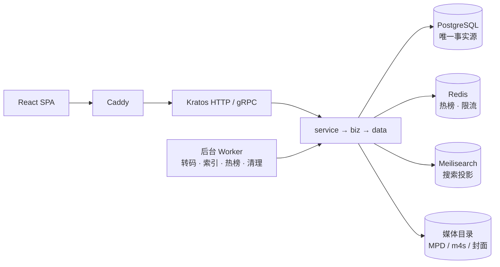
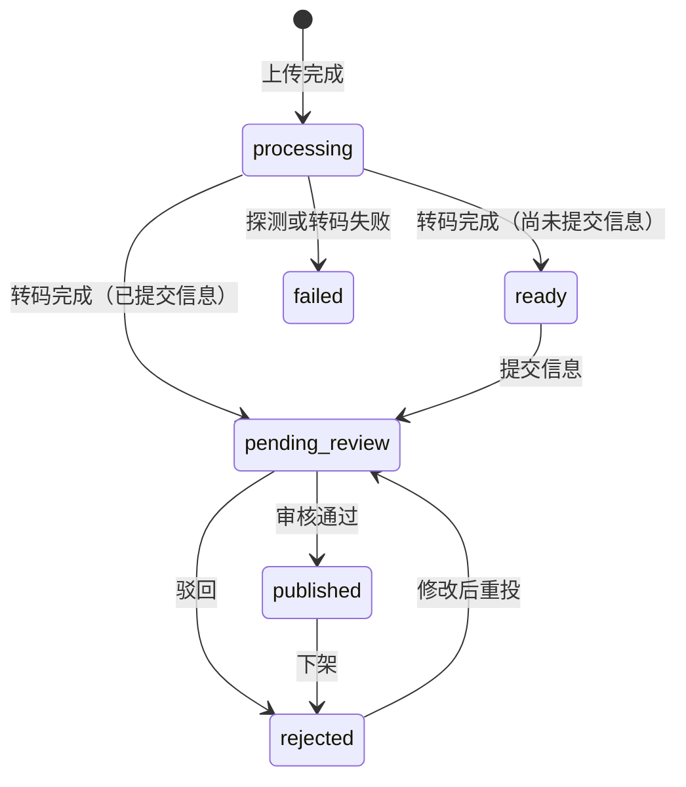

# bilibili-lite

一个围绕视频平台核心链路的全栈项目：投稿、转码、审核、播放、互动、搜索和热榜。后端用 Go + Kratos，前端用 React。

[在线体验](https://bilibili-lite.vercel.app/) · [项目仓库](https://github.com/Jingmozhiyu/bilibili-lite)

## 功能

- 注册登录（JWT access / refresh）、个人空间、头像
- 流式上传、用户容量配额、后台 FFmpeg 转码为 720p / 1080p 自适应 DASH
- 投稿审核：通过、驳回、重投、下架、删除
- 点赞、投币、收藏、分享、观看历史、两级评论、弹幕
- Meilisearch 中文全文搜索，不可用时降级到 PostgreSQL
- Redis 热榜，不可用时降级到 PostgreSQL 实时计算

## 架构



PostgreSQL 保存全部业务事实。Redis 和 Meilisearch 只是可以丢弃、可以从 PostgreSQL 重建的派生数据，故障时请求自动降级。后台 Worker 实现 Kratos `transport.Server` 接口，与 HTTP/gRPC 服务统一启停。

## 核心链路

### 投稿与转码

上传接口只负责把源文件流式落盘、在同一事务里校验配额并入队，随后立即返回 BVID。用户可以马上填写标题和标签离开页面。转码由后台 Worker 从数据库队列中领取。



- 任务即 `videos` 表中的行，Worker 用 `FOR UPDATE SKIP LOCKED` 领取；并发数可配置，默认 1 个 FFmpeg 进程。
- "提交信息"和"转码完成"可能以任意顺序发生，两边都在行锁内读写，最终都会收敛到正确状态。
- 进程中断留下的领取记录会被定期回收并重试；DASH 产物先写入私有目录，完成后整体 rename 发布。

### 搜索

视频行的相关字段一变化，数据库触发器就写入 `video_search_outbox`（每个视频一行，自动合并重复事件）。独立 Worker 领取后从 PostgreSQL 读取最新状态，写入或删除 Meilisearch 文档，失败则指数退避重试。查询时 Meilisearch 只返回有序 ID，再回 PostgreSQL 校验发布状态并取完整数据。

### 热榜

Worker 每 30 秒按"对数加权互动分 + 随发布时间指数衰减的新鲜度加分"重算全部已发布视频，并在一个 Redis 事务里整体替换 Sorted Set。首页读 ZSet 后回 PostgreSQL 校验数据；Redis 不可用时直接在 PostgreSQL 中计算。

### 互动

点赞、收藏采用"设置目标状态"而非"切换"的接口，重复请求天然幂等；计数与互动记录在同一事务中更新。分享以客户端 request ID 去重。播放量需要观看满 5 秒，且同一用户对同一视频每小时最多计 1 次、每天最多 10 次。

## 运行约束

- 仅接受带音视频轨的 MP4；画面高度低于 720p 时拒绝转码，输出不放大。
- 单文件默认上限 2 GiB，普通用户总配额 10 GiB。
- 媒体文件保存在宿主机目录，多节点部署需要换成对象存储。
- 需要备份的只有 PostgreSQL 和媒体目录。

## 目录结构

```text
api/                 Protobuf 接口定义与生成代码
cmd/bilibili-lite/   程序入口与 Wire 装配
configs/             非敏感运行配置
internal/server/     HTTP/gRPC Server 与路由
internal/service/    DTO ↔ 领域对象
internal/biz/        领域对象、用例与 Repo 接口
internal/data/       PostgreSQL / Redis / Meilisearch 实现与 SQL 迁移
internal/media/      上传、ffprobe、FFmpeg、DASH 文件管理
internal/worker/     转码、搜索索引、热榜、上传清理
internal/middleware/ JWT、RBAC、Redis 限流
web/                 React 前端
```

## 本地开发

```bash
cp .env.example .env
mkdir -p data/media
docker compose --env-file .env up -d --build   # 后端与依赖

cd web && npm install && npm run dev            # 前端
```

检查：

```bash
go test ./...
cd web && npm run lint && npm run build
```

修改 Protobuf、配置结构或 Wire 依赖图后，分别运行 `make api`、`make config` 或 `make all`。
